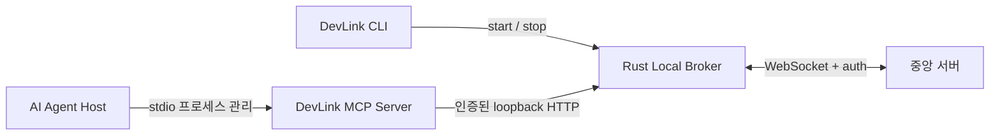

# MCP 실행 구조·로컬 통신 인터페이스 초안 v1

상태: **A1~A10 가확정안 유지 방향, 핵심 3개 항목 최종 협의 대기**. 작성일 2026-10-26, 협의 상태 갱신일 2026-10-27 (Asia/Seoul).

## 협의 상태와 결정 범위

MCP 측에서 전달한 A1~A10 가확정안을 검토했으며, 사용자 검토 기준으로 큰 방향을 유지하고 아래 세 항목을 확정하는 데 협의를 집중합니다. 이는 상대 담당자와의 최종 상호 합의나 구현 완료를 의미하지 않습니다. 아래 제안값은 최종 결정 전까지 구현 계약으로 확정하지 않습니다.

| 핵심 협의 항목 | 결정할 내용 | 현재 제안 | 현재 구현과 차이 |
| --- | --- | --- | --- |
| 세션 활성화와 재시작 후 소유권 | 활성화 시점, Agent ID 재사용, 신규 연결의 교체 권한과 복구 요청 구분, 등록 멱등성, 재시작 후 소유권 | 탐색·메타데이터·진단은 활성화·교체를 유발하지 않고 등록·재개 경로에서 활성화. MVP는 먼저 복구한 세션이 빈 슬롯을 확보하며 복구로 다른 활성 세션을 교체하지 않는 방안 | Agent 세션 등록·교체·갱신·만료는 신규 구현 필요. 재시작 전 최신 소유자 보존 여부와 신규 교체 권한의 확인 방법은 미확정 |
| CLI 설정 파일과 자격 수명주기 | 경로·스키마·환경변수 키, OS별 파일 보호·완결된 스냅샷, 토큰 유지·회전, MCP 파일 읽기·권한 | 일반 재시작에는 로컬 토큰 유지, 명시적 교체 시 MCP 재시작. 영속 자격 파일과 `runtime.json` 분리, 브로커 `instanceId`는 시작마다 변경 | 현재 로컬 토큰은 시작마다 재생성하고 `runtime.json`에 저장. Windows ACL 설정·검증은 미구현이며 동일 토큰이 상태 조회와 종료를 모두 허용 |
| HTTP 계약과 중앙 위임 경계 | 포트, 세션·기능별 method·path·버전·JSON·오류, 요청 식별·멱등성·timeout 후 결과 확인, 중앙 권한·업무 상태 책임 | 기본 포트 43127 사용. 세션은 브로커가 관리하고 Agent 권한·업무 상태의 최종 판단은 중앙에 위임. 업무 자동 재전송 및 로컬 만료에 따른 중앙 작업 상태 변경 금지 | 현재 `/health`, `/shutdown`만 구현. `localPort: 0` 허용 범위, MCP의 종료 권한, 세션·업무 API 및 중앙 메시지 계약은 확정 필요 |

검토 기준으로 유지하는 큰 구조는 CLI의 브로커 제어, Host의 stdio MCP 제어, MCP→로컬 HTTP→브로커→중앙 전달, 중앙 토큰의 브로커 관리입니다. 브로커 장애에도 MCP 진단을 유지하고, 오류를 이유로 공유 브로커를 자동 기동·종료하지 않는 방향을 유지합니다.

세부 쟁점은 위 세 항목 안에서 결정합니다. 교체 권한 확인은 첫 번째 항목, MCP의 종료 권한은 두 번째·세 번째 항목, 업무 timeout 후 결과 확인은 세 번째 항목에 포함합니다. 30초 갱신·90초 만료는 MCP 측 가확정안의 설정 가능한 초기값이며 구현·검증 완료값이 아닙니다.

MVP에서 빈 슬롯 선점 복구를 채택하면 재시작 전 최신 소유자는 보존되지 않을 수 있습니다. 이 한계를 수용할지, 소유 정보를 보관할지는 최종 합의에 명시해야 합니다. 세 항목이 결정되면 결정값·API 명세·담당 범위와 수용 시나리오 검증 결과를 이 문서에 기록합니다.

## 프로세스 소유권 제안



CLI와 브로커는 동일 실행 파일을 다른 모드로 실행하되 별도 프로세스입니다. CLI가 브로커를 시작하고 준비 상태를 확인하며 사용자의 `stop` 요청을 중계합니다. 브로커는 CLI 종료 후 유지됩니다. Agent Host가 MCP stdio 서버를 시작·종료하며 MCP 서버 종료가 브로커 종료로 이어지지 않는 구조를 제안합니다. MCP 서버는 중앙 WebSocket을 직접 소유하지 않습니다.

소스는 `rust/crates/devlink-cli` 실행 파일 크레이트와 `rust/crates/devlink-broker` 라이브러리 크레이트로 분리합니다. CLI의 숨겨진 `broker` 명령이 라이브러리를 실행하므로 별도 브로커 실행 파일 설치 없이 같은 프로세스 구조를 유지합니다.

담당자 1의 제안 범위는 Rust CLI, 설정, 브로커 수명 주기, 로컬 HTTP, 중앙 연결과 통합 테스트입니다. 담당자 2의 제안 범위는 MCP 서버, Tool 스키마, Agent 등록과 Tool→내부 API 매핑입니다. 실제 담당자 번호·소유권은 회의에서 확인해야 합니다. Agent 프로그램 자체 실행·종료와 MCP 자동 등록은 이번 Rust 구현에 포함하지 않습니다.

## 현재 구현된 로컬 연결과 발견

이 절은 현재 코드의 동작입니다. 위 협의안의 토큰 유지·파일 분리·고정 포트 정책이 이미 반영되었다는 의미는 아닙니다.

- 전송: HTTP/1.1 JSON, IPv4 `127.0.0.1`에만 바인딩. 기본 포트 43127, `localPort: 0`이면 자동 할당.
- 발견: CLI와 MCP가 같은 설정 디렉터리의 `runtime.json`을 읽습니다. 디렉터리당 한 인스턴스입니다.
- 런타임 필드: `apiVersion`, `pid`, `port`, `instanceId`, `controlToken`. 토큰과 전체 런타임 JSON은 로그·Tool 응답에 포함하지 않습니다.
- 인증: 각 요청에 `Authorization: Bearer <controlToken>`. `Origin`이 있는 브라우저 요청은 거절하며 CORS 허용 헤더를 제공하지 않습니다.
- 클라이언트는 프록시를 끄고 loopback으로만 요청해야 합니다. `GET /health`의 서비스·API 버전·PID·instanceId를 확인합니다.
- 새 브로커마다 instanceId와 제어 토큰이 바뀝니다. MCP 클라이언트는 브로커 재시작 후 런타임 정보를 다시 읽어야 합니다.
- 중앙 `DEVLINK_TOKEN`은 로컬 제어 토큰과 별개이며 MCP 클라이언트가 읽거나 반환할 필요가 없습니다.

OS 잠금은 실행 여부의 기준이며 런타임 파일의 PID만 보고 프로세스를 종료하면 안 됩니다. 잠금은 살아 있는데 파일/API가 손상된 경우 실행 여부를 `unknown/unhealthy`로 처리합니다.

## 구현된 API

| 호출 | 권한/책임 | 성공 응답 |
| --- | --- | --- |
| `GET /health` | CLI 및 향후 MCP 상태 조회 | 200, 아래 Health JSON |
| `POST /shutdown` | CLI 수명 주기 제어. MCP Tool에 노출하지 않는 것을 제안 | 202, `{"apiVersion":1,"status":"stopping"}` |

```json
{
  "service": "devlink-broker",
  "apiVersion": 1,
  "pid": 12345,
  "instanceId": "uuid",
  "centralServer": "Connected"
}
```

요청 본문은 두 경로 모두 사용하지 않습니다. Health의 상태 enum은 README에 정의되어 있습니다. 인증 실패는 401, 알 수 없는 경로는 404이며 다음 JSON을 반환합니다. 지원하지 않는 HTTP method는 axum 기본 405 응답이므로 본문 형식을 가정하지 않습니다.

```json
{
  "apiVersion": 1,
  "error": { "code": 401, "message": "Unauthorized" }
}
```

클라이언트 타임아웃 기준은 조회/종료 요청 1초, 시작 확인 8초, 종료 확인 8초입니다. 네트워크 오류·잘못된 JSON·서비스/버전/인스턴스 불일치는 로컬 클라이언트 오류로 다룹니다. 서버 오류 원문, 토큰, 임의 중앙 payload를 Tool 오류에 노출하지 않습니다. 중앙 연결 실패는 HTTP 실패가 아닌 Health의 연결 상태로 표현합니다.

## MCP Tool 매핑 제안과 미구현 범위

기존 초안에서는 입력 없는 `devlink_status`와 `BROKER_NOT_RUNNING` 오류를 제안했습니다. 이는 초기 매핑 예시이며, 전달받은 MCP Tool 목록이나 확정 계약을 대신하지 않습니다. 최종 Tool 매핑·오류 규격은 핵심 협의 항목 중 HTTP 계약과 중앙 위임 경계에 포함해 확정합니다. 브로커가 없을 때 MCP가 임의로 실행하지 않고 사용자에게 `devlink start`를 안내하는 방향을 유지합니다.

작업 제출, Agent/세션 목록, 실행 취소, 로그 구독, 중앙 응답 라우팅 API는 **구현하지 않았습니다**. 다음 항목을 MCP 담당자·중앙 서버 담당자와 확정한 뒤 버전이 있는 `/v1/...` API로 추가합니다.

| 협의 항목 | 결정할 내용 |
| --- | --- |
| 세션 활성화와 재시작 후 소유권 | 활성화·Agent ID 재사용·등록 멱등성·교체 권한·복구·만료·재시작 후 소유권 |
| CLI 설정 파일과 자격 수명주기 | 파일 경로·스키마·OS별 보호·토큰 유지 및 회전·MCP 읽기 방식·제어 권한 |
| HTTP 계약과 중앙 위임 경계 | 포트·버전·API·메시지·오류·timeout·결과 확인·종료 권한·중앙 인증 및 작업 상태 책임 |

협의 기록에는 참석자·날짜·세 항목별 최종 결정·남은 쟁점·담당 범위를 추가해야 합니다. 현재 API를 MCP 프로토콜 엔드포인트로 사용하면 안 되며, MCP 서버는 별도 프로토콜 어댑터입니다.
