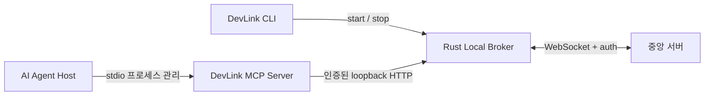

# MCP 실행 구조·로컬 통신 인터페이스

상태: **기존 MCP v0.1 규칙을 Rust 구현 기준으로 채택. 자격 파일·토큰 관리·권한 분리는 구현됐으며 세션·업무 API와 실제 상호 검증은 미완료**. 작성일 2026-10-26, 규칙 채택일 2026-10-27, 구현 현황 갱신일 2026-10-28 (Asia/Seoul).

## 2026-10-28 중앙 WebSocket 규칙 확인

중앙 서버의 보안 전략과 2026-10-27 작업 기록을 확인해 [중앙 WebSocket 연동 규칙](central-websocket-contract.md)에 Rust 적용 기준을 기록했습니다. `/ws/broker`의 Agent 토큰 인증, `BROKER_READY`, `AGENT_PRESENCE`, 동일 Agent 연결 교체·종료 보호는 문서에 정의돼 있으므로 해당 규칙을 따릅니다. 아래의 포괄적인 중앙 인증·메시지 협의 표기는 이 구체적인 규칙과 후속 항목을 구분해 읽습니다.

중앙은 인증 Principal과 DB의 Agent 소유자·팀을 검증합니다. READY에는 `connection_id`와 숫자 `agent_id`만 있으며 사용자·팀 필드를 추가하는 계약은 없습니다. MCP 세션 principal에 필요한 `userId/teamId` 전달 경로와 최초 Agent 등록·토큰 발급 흐름의 연결은 별도 후속 항목입니다. 중앙 Heartbeat의 20초·20초·40초는 초기안이며 현재 Rust의 5초 Ping·15초 초과 무응답 판정과 정합성을 확인해야 합니다. presence는 공유 `CentralState::set_presence`로 게시하면 READY·변경·재접속 시 보고하도록 구현했으며, 실제 로컬 세션의 생성·bind·해제·만료 이벤트 연결과 업무 라우팅·수신함 ACK는 남아 있습니다.

## 협의 상태와 결정 범위

2026-10-27 저장소의 [MCP → 로컬 브로커 계약 v0.1](../../packages/mcp-server/docs/broker-contract-v0.1.md)과 `packages/mcp-server/src/broker/`의 현재 규칙을 Rust 구현 기준으로 채택합니다. 브로커 재시작 후 소유권은 먼저 유효하게 복구한 인스턴스가 해당 Agent의 빈 슬롯을 확보하는 방식으로 정합니다. 이전 소유자는 보존하지 않습니다.

이는 사용자 측 구현 방향의 확정이며 상대 담당자의 추가 승인, 실제 Rust 구현 완료, 실제 MCP·중앙 서버 상호 검증 완료를 의미하지 않습니다. MCP 규칙에 없는 파일 배치·프로필·권한 범위·중앙 메시지·설치 방식까지 함께 확정한 것으로 해석하지 않습니다. 중앙 서버 연결은 중앙 담당자의 계약을 따르며 로컬 세션 규칙과 별도로 연결합니다.

| 핵심 항목                      | 채택 범위                                                                       | Rust 구현 기준                                                                                                                                    | 남은 결정·구현                                                                                                                  |
| ------------------------------ | ------------------------------------------------------------------------------- | ------------------------------------------------------------------------------------------------------------------------------------------------- | ------------------------------------------------------------------------------------------------------------------------------- |
| 세션 활성화와 재시작 후 소유권 | 지연 활성화, fresh/recover, 세션 등록 멱등성, 선복구 소유권, 갱신·만료·해제     | 유효한 업무 도구 요청부터 세션 활성화. 인증된 fresh는 기존 소유자 교체 가능, recover는 자기 세션·빈 슬롯만 확보. 재시작 전 소유자는 보존하지 않음 | Rust 세션 API 신규 구현. Agent ID 영속 저장·재사용 경로와 중앙 등록 응답 유실 시 중복 방지 방식은 추가 결정 필요                |
| CLI 설정 파일과 자격 수명주기  | MCP 스키마 v1, DEVLINK_BROKER_FILE, 비공개 파일 검사, 토큰 유지·회전            | `.devlink-runtime/broker.json` 원자 발행·토큰 유지·중지 중 회전·OS 권한 검사 구현. CLI runtime의 controlToken과 MCP localToken 분리 | Host별 프로필·신원 분리 정책, Agent ID 영속 재사용, 동적 포트에서 주소 변경 후 재시작 흐름과 Unix 실행 검증 필요 |
| HTTP 계약과 중앙 위임 경계     | loopback HTTP, /v1 세션·7개 업무 경로, JSON·오류 해석, timeout·업무 재전송 금지 | MCP 계약·현재 클라이언트와 호환되는 API 제공. 신원은 브로커·중앙이 검증하며 로컬 만료·timeout으로 중앙 작업 상태를 변경하지 않음                  | Rust에는 /health, /shutdown만 구현. 세부 HTTP 상태 매핑·고정/동적 포트 운영·중앙 인증 및 메시지 매핑·결과 확인 경로는 보완 필요 |

검토 기준으로 유지하는 큰 구조는 CLI의 브로커 제어, Host의 stdio MCP 제어, MCP→로컬 HTTP→브로커→중앙 전달, 중앙 토큰의 브로커 관리입니다. 브로커 장애에도 MCP 진단을 유지하고, 오류를 이유로 공유 브로커를 자동 기동·종료하지 않는 방향을 유지합니다.

### 채택한 MCP 규칙

- 탐색·메타데이터·MCP 도구 목록(`tools/list`)·`devlink_ping`은 세션을 활성화하지 않습니다. 업무 도구 `list_agents`는 별도이며 현재 MCP에서는 세션 활성화 후 Agent 등록 여부를 검사합니다. 미바인딩 세션에서는 `register_agent`만 허용합니다.
- MCP 프로세스의 고정 UUID `instanceId`로 세션을 식별합니다. 첫 세션 생성 시도는 `fresh`, 이후에는 응답 유실 여부와 관계없이 `recover`를 사용하며 같은 인스턴스의 세션 생성은 멱등적이어야 합니다. 브로커 자신의 `instanceId`와 구분합니다.
- 인증된 `fresh`는 해당 Agent의 기존 소유자를 교체할 수 있습니다. `recover`는 자기 세션 또는 빈 슬롯만 확보하며 다른 소유자가 있으면 `SESSION_CONFLICT`입니다. 교체된 세션은 `SESSION_REPLACED`로 처리하고 오래된 갱신·해제가 새 세션에 영향을 주지 않게 합니다.
- 브로커 재시작 후 같은 Agent의 빈 슬롯은 먼저 유효하게 복구한 인스턴스가 확보합니다. 이전 소유권은 보존하지 않으며 다른 Agent들은 각자 별도 슬롯을 사용합니다.
- MCP 갱신 기본 30초, 브로커 lease 기본 90초를 채택합니다. 브로커 수신 기준 시간으로 판단하고 클라이언트 시각은 신뢰하지 않습니다. 중앙 서버의 브로커 Heartbeat와 별도입니다.
- 세션 자동 복구는 기본 최대 5회, 1초부터 최대 30초 지수 백오프입니다. 소유권 충돌·교체·인증 거절·잘못된 자격 파일은 자동 복구를 중단합니다. 업무 요청은 자동 재전송하지 않습니다.
- 자격 파일은 `schemaVersion: 1`, `brokerUrl`, `localToken`, 선택적 `agentId`의 엄격한 스키마를 사용하며 `DEVLINK_BROKER_FILE`에 절대 경로를 전달합니다. 토큰은 16~4096자의 영문·숫자·`.`·`_`·`~`·`-`를 허용합니다. 중앙 토큰은 전달하지 않습니다.
- 자격은 일반 파일·16KiB 이하·비공개 권한이어야 하고 파일 및 직계 부모의 심볼릭 링크를 거부합니다. POSIX 소유권·파일 권한·부모 쓰기 권한, Windows 소유권·DACL은 현재 MCP 검사에 맞춥니다. CLI가 완결된 스냅샷을 원자적으로 발행합니다.
- MCP는 주소·토큰을 실행 중 고정합니다. 일반 브로커 재시작에는 토큰을 유지하고 명시적 회전에는 MCP를 재시작합니다. 주소를 바꿀 때도 현재 클라이언트를 다시 시작해야 합니다.
- 로컬 전송은 포트가 명시된 `http://127.0.0.1:<port>`와 Bearer 토큰·JSON이며 리다이렉트를 허용하지 않습니다. 세션 4개 경로와 업무 7개 경로·JSON은 MCP 계약을 따릅니다.
- 응답은 같은 `requestId`와 `data` 또는 `error`를 사용합니다. HTTP 401·403은 현재 MCP의 인증·권한 오류 해석을 따릅니다. 세션 오류 코드도 그대로 사용하되 테스트 대역이 쓰는 409를 모든 실패의 공동 상태 코드로 확정하지 않습니다.
- 요청 기본 제한 10초(응답 본문 수신 포함), 요청 128KiB·응답 256KiB를 채택합니다. timeout·단절·취소·프로토콜 오류는 업무 결과 불명이며 중앙 작업을 임의 실패·취소·재할당하지 않습니다. 요청 추적 ID는 중앙 멱등성 보장의 대체물이 아닙니다.
- MCP 종료 시 진행 요청·타이머를 정리하고 최대 1초 동안 세션 해제를 시도합니다. 해제 실패는 MCP 종료를 막지 않으며 공유 브로커를 종료하지 않습니다.

### MCP 규칙 밖에 남은 결정

- 현재 자격 파일은 `--config`의 설정 디렉터리 아래 `.devlink-runtime/broker.json`이며 runtime과 별도 파일로 발행합니다. 별도 디렉터리는 별도 브로커·자격을 사용합니다. 하나의 브로커에서 Host별 프로필·토큰·신원을 관리하는 제품 정책과 자격 삭제 수명 주기는 후속 항목입니다.
- 중앙에서 검증된 Agent ID의 저장·재사용, 중앙 등록 성공 응답 유실 시 중복 방지. 현재 MCP는 읽기와 프로세스 메모리 보관만 수행하며 `config.agent`를 등록 ID로 간주하지 않습니다.
- CLI/MCP 자격 분리와 `/shutdown` 권한은 구현됐습니다. 이 권한 경계를 세션·업무 API에도 적용하고 검증된 중앙 신원과 연결해야 합니다. 현재 Rust 발행 스키마에는 `agentId`가 없습니다.
- 기본 포트 43127을 포함한 실제 포트 운영과 `localPort: 0` 허용 범위. 재시작 중 주소가 달라지면 현재 MCP의 자동 복구 전제와 맞지 않습니다.
- 중앙 인증 정보·메시지·업무 DTO와의 매핑, 등록 멱등성·timeout 후 결과 확인 방법, 세부 HTTP 상태 매핑. 중앙 서버 계약을 따르며 필요한 정보가 없을 때 임의 신원을 만들지 않습니다.
- Host 지원·등록 범위, 설치 경로, Node 사전 설치/동봉, 기존 설정 병합·백업·복구. 현재 MCP의 Node 24 이상 요구사항과 제품 설치 방식을 구분합니다.

수용 검증은 T1~T8과 MCP 재실행 후 Agent ID 재사용(T9)을 기준으로 계획합니다. 자격 파일의 실제 MCP reader 호환성, 정상·강제 종료 후 토큰 유지, 회전·권한 분리는 Rust 통합 테스트로 확인했습니다. 선복구 충돌·오래된 갱신/해제·등록 응답 유실·만료·파일 갱신 중 읽기·무응답 종료·업무 timeout은 실제 Rust 세션·업무 API와 MCP를 연결해 검증해야 합니다. 기존 가짜 브로커 테스트는 실제 연동 완료의 증거가 아닙니다.

## 프로세스 소유권 제안



CLI와 브로커는 동일 실행 파일을 다른 모드로 실행하되 별도 프로세스입니다. CLI가 브로커를 시작하고 준비 상태를 확인하며 사용자의 `stop` 요청을 중계합니다. 브로커는 CLI 종료 후 유지됩니다. Agent Host가 MCP stdio 서버를 시작·종료하며 MCP 서버 종료가 브로커 종료로 이어지지 않는 구조를 제안합니다. MCP 서버는 중앙 WebSocket을 직접 소유하지 않습니다.

소스는 `rust/crates/devlink-cli` 실행 파일 크레이트와 `rust/crates/devlink-broker` 라이브러리 크레이트로 분리합니다. CLI의 숨겨진 `broker` 명령이 라이브러리를 실행하므로 별도 브로커 실행 파일 설치 없이 같은 프로세스 구조를 유지합니다.

담당자 1의 제안 범위는 Rust CLI, 설정, 브로커 수명 주기, 로컬 HTTP, 중앙 연결과 통합 테스트입니다. 담당자 2의 제안 범위는 MCP 서버, Tool 스키마, Agent 등록과 Tool→내부 API 매핑입니다. 실제 담당자 번호·소유권은 회의에서 확인해야 합니다. Agent 프로그램 자체 실행·종료와 MCP 자동 등록은 이번 Rust 구현에 포함하지 않습니다.

## 현재 구현된 로컬 연결과 발견

이 절은 2026-10-28 현재 코드의 동작입니다. 자격 파일·토큰·권한 분리는 구현됐으며 세션·업무 API는 후속 작업입니다.

- 전송: HTTP/1.1 JSON, IPv4 `127.0.0.1`에만 바인딩. 기본 포트 43127, `localPort: 0`이면 자동 할당. MCP URL 검증과 맞추기 위해 포트 80은 거부합니다.
- 발견: Rust CLI는 설정 디렉터리 아래의 `.devlink-runtime/runtime.json`을 읽고 MCP는 같은 디렉터리의 `broker.json`을 읽습니다. `devlink [--config <FILE>] mcp path`는 자격 파일 경로만 출력하며 파일을 생성하지 않습니다. 브로커 기동 시 스냅샷을 발행합니다. `broker.lock`과 `control.lock`도 `.devlink-runtime/`에 저장하며, 설정 디렉터리당 한 인스턴스입니다. 구버전 브로커는 업그레이드 전에 구버전 CLI로 종료해야 합니다.
- 런타임 필드: `apiVersion`, `pid`, `port`, `instanceId`, `controlToken`. 토큰과 전체 런타임 JSON은 로그·Tool 응답에 포함하지 않습니다.
- 인증: `Authorization: Bearer <토큰>`을 사용합니다. CLI의 `controlToken`과 MCP의 `localToken` 모두 health를 조회할 수 있지만 `/shutdown`은 CLI 제어 토큰만 허용합니다. `Origin`이 있는 브라우저 요청은 거절하며 CORS 허용 헤더를 제공하지 않습니다.
- 클라이언트는 프록시를 끄고 loopback으로만 요청해야 합니다. `GET /health`의 서비스·API 버전·PID·instanceId를 확인합니다.
- 새 브로커마다 instanceId와 CLI 제어 토큰은 바뀌지만 MCP localToken은 정상·강제 종료 후 재시작에 유지합니다. `devlink mcp rotate`는 브로커 중지 중에만 새 MCP 토큰을 발행하며 start/stop과 잠금으로 조정합니다. MCP는 자격 파일을 실행 중 다시 읽지 않으므로 회전 후 재시작해야 합니다.
- 브로커는 현재 바인딩된 포트로 brokerUrl을 발행합니다. `localPort: 0`이나 설정 변경으로 주소가 달라지면 MCP도 다시 시작해야 합니다.
- 자격 파일은 16KiB 이하이며 원자적으로 발행하고 파일·직계 부모의 링크 및 Windows reparse point를 거부합니다. Windows 소유권·DACL 설정·검증은 실행 확인했고 Unix 소유권·권한 검사 코드는 실행 미검증입니다. 손상되거나 권한이 안전하지 않은 자격은 기동 시 오류로 처리합니다.
- 중앙 `DEVLINK_TOKEN`은 로컬 제어 토큰과 별개이며 MCP 클라이언트가 읽거나 반환할 필요가 없습니다.

OS 잠금은 실행 여부의 기준이며 런타임 파일의 PID만 보고 프로세스를 종료하면 안 됩니다. 잠금은 살아 있는데 파일/API가 손상된 경우 실행 여부를 `unknown/unhealthy`로 처리합니다.

## 구현된 API

| 호출             | 권한/책임                                              | 성공 응답                                   |
| ---------------- | ------------------------------------------------------ | ------------------------------------------- |
| `GET /health`    | CLI controlToken 및 MCP localToken으로 상태 조회 | 200, 아래 Health JSON                       |
| `POST /shutdown` | CLI controlToken만 허용. MCP localToken은 401 | 202, `{"apiVersion":1,"status":"stopping"}` |

```json
{
  "service": "devlink-broker",
  "apiVersion": 1,
  "pid": 12345,
  "instanceId": "uuid",
  "centralServer": "Connected"
}
```

요청 본문은 두 경로 모두 사용하지 않습니다. Health의 상태 enum은 README에 정의되어 있습니다. 인증 실패는 401, 알 수 없는 경로는 404이며 다음 JSON을 반환합니다. 지원하지 않는 HTTP method는 axum 기본 405 응답이므로 본문 형식을 가정하지 않습니다.

```json
{
  "apiVersion": 1,
  "error": { "code": 401, "message": "Unauthorized" }
}
```

클라이언트 타임아웃 기준은 조회/종료 요청 1초, 종료 확인 8초입니다. 시작 확인은 기본 준비·health 여유 8초에 Windows 자격 검사의 최대 3회 × 5초를 더한 23초이며, Unix는 기존 8초입니다. ACL 검사를 생략하지 않고 자격 발행 전 준비 시간을 포함합니다. 네트워크 오류·잘못된 JSON·서비스/버전/인스턴스 불일치는 로컬 클라이언트 오류로 다룹니다. 서버 오류 원문, 토큰, 임의 중앙 payload를 Tool 오류에 노출하지 않습니다. 중앙 연결 실패는 HTTP 실패가 아닌 Health의 연결 상태로 표현합니다.

## MCP Tool 매핑과 미구현 범위

기존 초안의 `devlink_status`·`BROKER_NOT_RUNNING` 예시 대신 현재 MCP의 `devlink_ping`, 7개 업무 도구 및 `BROKER_UNAVAILABLE` 등 실제 오류 해석을 기준으로 합니다. 브로커가 없을 때 MCP가 임의로 실행하지 않고 사용자에게 `devlink start`를 안내하는 구조를 유지합니다.

현재 Rust에는 세션·업무 `/v1/...` API가 **구현되지 않았습니다**. MCP에는 업무 도구와 클라이언트가 있으며, 채택한 계약에 맞는 Rust API·중앙 매핑을 구현해야 합니다. 실행 취소·로그 구독을 이번 MCP 계약 채택만으로 추가 범위에 포함하지 않습니다.

| 협의 항목                      | 결정할 내용                                                                     |
| ------------------------------ | ------------------------------------------------------------------------------- |
| 세션 활성화와 재시작 후 소유권 | 채택한 세션 규칙의 Rust 구현·검증, Agent ID 영속 재사용과 중앙 등록 멱등성 보완 |
| CLI 설정 파일과 자격 수명주기  | 구현된 자격 발행·토큰·권한 분리를 유지하며 Host별 프로필 정책·Agent ID 영속 재사용·주소 변경 흐름과 Unix 실행 검증 보완 |
| HTTP 계약과 중앙 위임 경계     | MCP API 호환 구현, 중앙 계약 매핑·결과 확인·세부 HTTP 상태·포트 운영 보완       |

후속 협의에서는 기존 MCP 규칙 자체를 미확정으로 되돌리지 않고 위 잔여 결정·담당 범위·수용 검증 결과를 기록합니다. 현재 제어 API를 MCP 프로토콜 엔드포인트로 사용하면 안 되며, MCP 서버는 별도 프로토콜 어댑터입니다.

## 다음 구현: Rust 세션 API

1. `POST /v1/sessions`의 지연 활성화·instanceId 멱등성·fresh/recover 소유권과 `POST /v1/sessions/:sessionId/bind`의 Agent 소유 검증을 구현합니다.
2. `POST /v1/sessions/:sessionId/heartbeat`, `DELETE /v1/sessions/:sessionId`, 브로커 시계 기준 lease 90초와 오래된 갱신·해제 차단을 구현합니다. MCP heartbeat 기본 30초는 중앙 WebSocket Ping/Pong과 별도입니다.
3. 검증된 로컬 세션 상태를 `CentralState::set_presence`에 연결합니다. 생성·bind·해제·만료에서 어떤 상태가 확인됐는지 판단하며 단순 세션 생성만으로 ONLINE을 추측하지 않습니다.
4. 중앙에서 검증된 `userId/teamId` 전달 경로를 연결합니다. READY의 agent_id나 클라이언트 입력만으로 사용자·팀 신원을 만들지 않습니다. 실제 중앙 신원 연결 전에는 세션 로직의 로컬 검증과 실제 MCP 연동 완료를 구분합니다.
5. 실제 Rust와 MCP로 생성·bind·갱신·해제, 선복구 충돌·교체·만료·재시작을 검증한 뒤 업무 API 7개와 중앙 라우팅·수신함·ACK 연동을 진행합니다.
